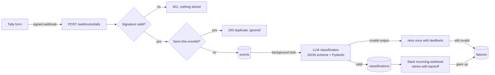

# SupportFlow

An AI support-automation pipeline. Customer messages arrive from a Tally form as signed webhooks, an LLM classifies each one into structured fields, and a summary is posted to Slack. Every step is stored, and every failure is recorded with the stage where it happened.

Messages can be in English, Bangla, or a mix of both.

## How it works



1. **Intake.** The webhook endpoint verifies Tally's HMAC-SHA256 signature over the raw body, rejects anything unsigned, and stores the event. It responds immediately with `202 Accepted`.
2. **Classification.** A background task sends the message to the LLM, which must return JSON matching a schema: category, urgency, sentiment, language, order ID and a one-line summary. The output is validated with Pydantic.
3. **Notification.** The result is posted to a Slack channel.
4. **Monitoring.** `/events` shows recent events and their status; `/failures` shows what went wrong and where.

## Tech stack

Python, FastAPI, SQLAlchemy 2.0 (SQLite locally, Postgres-ready), Pydantic, httpx, Ollama (local LLM, `qwen2.5:3b` by default), Slack incoming webhooks, pytest, GitHub Actions.

## Design decisions

- **Verify before parsing.** The signature is checked on the raw request bytes before the body is parsed or stored, and the comparison is constant-time. If no secret is configured (or the `.env.example` placeholder is left in place), every request is rejected and a warning is logged at startup, so a misconfigured server fails closed.
- **Idempotent intake.** Webhook senders retry, so the same event can arrive more than once. Tally's `eventId` has a unique index; a repeat delivery returns `200 duplicate` and is not processed again, even if two deliveries race.
- **Respond fast, work later.** The endpoint only verifies and stores. Classification and Slack run after the response is sent, so a slow model never causes Tally to time out and retry.
- **Structured, validated LLM output.** The model is constrained to a JSON schema, and the result is validated again with Pydantic. Invalid output gets one retry that tells the model what was wrong; if it still fails, the failure is recorded instead of crashing the worker.
- **Provider interface.** The pipeline talks to an `LLMProvider` interface. Ollama keeps the project free and offline; a cloud model is a new class and one setting, with no pipeline changes.
- **Safe to re-run.** An event that is already classified is never sent to the LLM again; if only the Slack step failed, `scripts/replay_events.py` resends the notification without paying for a second classification.
- **Retry only what can succeed.** Slack calls retry network errors, `429` (honouring `Retry-After`, capped at 30 seconds) and `5xx` with exponential backoff. Other `4xx` errors and a malformed webhook URL fail immediately.
- **Bounded waits.** Slack calls time out after 10 seconds. Ollama gets `LLM_TIMEOUT_SECONDS` to generate, but only 10 seconds to connect, so an unreachable host fails fast.
- **Forms can change.** Tally fields are matched by label keywords, so the form can be edited without code changes.

## Getting started

Requirements: Python 3.11+, [Ollama](https://ollama.com), and optionally a Slack workspace, a [Tally](https://tally.so) form and [ngrok](https://ngrok.com).

```bash
git clone https://github.com/roy032/supportflow.git
cd supportflow
python -m venv .venv
.venv\Scripts\activate            # Windows
# source .venv/bin/activate       # macOS / Linux
pip install -r requirements-dev.txt

cp .env.example .env              # Windows: copy .env.example .env
# then edit .env: TALLY_SIGNING_SECRET, SLACK_WEBHOOK_URL

ollama pull qwen2.5:3b
uvicorn app.main:app --reload --port 8000
```

Open http://localhost:8000/docs for the interactive API docs.

### Try it without Tally

With the server running, in a second terminal:

```bash
python scripts/try_classifier.py "Where is my order ORD-12?"   # check the model on its own
python scripts/test_slack.py                                    # check the Slack connection
python scripts/send_test_webhook.py                             # send English, Bangla and spam samples
```

Then open http://localhost:8000/events to see how each one was classified.

### Replay failed events

Events that did not reach Slack (Ollama or Slack was down, the server restarted mid-task) can be run through the pipeline again:

```bash
python scripts/replay_events.py --dry-run               # list unfinished events
python scripts/replay_events.py                         # replay all of them
python scripts/replay_events.py --status notify_failed  # only Slack failures
python scripts/replay_events.py --event-id 12           # one event
```

Only events last updated at least 5 minutes ago are picked, so work the server is still doing is left alone. Notified events are never touched.

### Connect a real Tally form

1. Run `ngrok http 8000` and copy the `https://...` forwarding URL.
2. In Tally, open the form, go to **Integrations > Webhooks**, and add `https://<your-ngrok-url>/webhooks/tally`.
3. Set a signing secret there and put the same value in `TALLY_SIGNING_SECRET` in `.env`, then restart the server.
4. The form needs a field whose label contains "Message". Fields labelled with "Name", "Email" and "Order" are picked up too.

## API

| Method | Path | Purpose |
|---|---|---|
| `POST` | `/webhooks/tally` | Receive a signed Tally webhook (`202` accepted, `200` duplicate, `401` bad signature, `400`/`422` bad payload) |
| `GET` | `/events?limit=20` | Recent events with status and classification |
| `GET` | `/failures?limit=20` | Recent failures with pipeline stage and error |
| `GET` | `/health` | Liveness and database check |

Event status moves through `received`, `classified`, `notified`, or ends in `failed` (classification) or `notify_failed` (Slack).

## Tests

```bash
pytest -q
```

The suite covers signature verification, idempotency, payload parsing (including Bangla text), settings validation, classifier retries and validation, Slack retry behaviour, replay of unfinished events, and the full webhook-to-Slack flow. External services are mocked, so tests need no network, model or Slack workspace. GitHub Actions runs them on Python 3.11 to 3.13 on every push.

## Project layout

```
app/
  main.py         FastAPI app: webhook intake, /events, /failures, /health
  security.py     Tally signature verification
  tally.py        Tally payload -> SupportMessage
  classifier.py   Prompt, JSON schema, validation and retry logic
  llm/            LLMProvider interface and the Ollama provider
  pipeline.py     Classify -> store -> notify, with failure recording
  replay.py       Find unfinished events and run them through the pipeline again
  slack.py        Slack message formatting and retrying sender
  models.py       events, classifications, failures tables
scripts/          Test webhook sender, Slack test, classifier playground, event replay
tests/            pytest suite
RUNBOOK.md        What to check when something breaks
DEVELOPMENT.md    Conventions and commands for working on the code
```

## Known limitations

- Background tasks run in the web process. If the server restarts mid-task, that event stays `received` until it is replayed with `scripts/replay_events.py`. Retries after the in-request attempts are manual; there is no automatic retry queue yet.
- A small local model is fast and free but less accurate than larger models, especially on mixed-language messages.
- Only Tally is supported as a source so far.

## Roadmap

- Job queue with automatic retries and a dead-letter queue (manual replay already exists)
- RAG auto-replies for common questions, answered from the shop's policy documents
- Slack approve/edit buttons before a reply is sent
- Postgres and Docker Compose setup
- Daily summary report with n8n
- Evaluation set of labelled messages, comparing local and cloud models on accuracy, latency and cost

